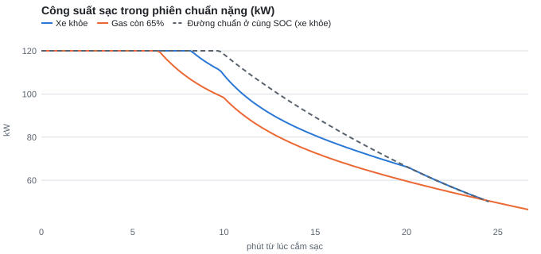
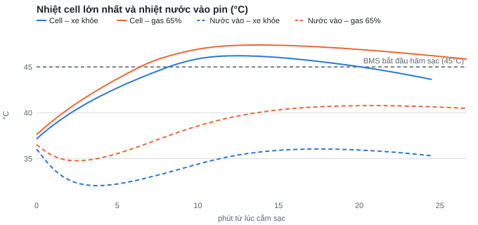
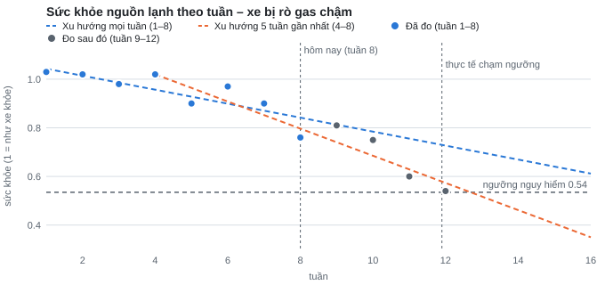

# BÁO CÁO VeHatI – NHÓM NHIỆT & ĐIỀU HÒA

**Đề tài chính:** Bài toán A – Sạc nhanh bị chậm do nhiệt → bộ phận làm mát pin nào đang yếu → dự báo sức khỏe bộ phận đó
**Ngày:** 15/10/2026
**Mục đích:** khảo sát các tín hiệu telemetry liên quan, đề xuất hướng giải và xác định dữ liệu cần có. Báo cáo **chưa kết luận về khả năng vận hành trên xe thật**.
**Trạng thái số liệu:** mọi con số chạy trên **các kịch bản mô phỏng minh họa**, chưa hiệu chuẩn theo xe VinFast thật. Đây là kết quả trên kịch bản tự dựng, **không phải độ chính xác đã kiểm chứng**. Mọi ngưỡng phải chỉnh lại khi có mẫu dữ liệu thật.

---

## Mục lục

1. [Tóm tắt](#1-tóm-tắt)
2. [Hệ thống nhiệt và luồng dữ liệu](#2-hệ-thống-nhiệt-và-luồng-dữ-liệu)
3. [Phát biểu bài toán A](#3-phát-biểu-bài-toán-a)
4. [Dữ liệu](#4-dữ-liệu)
5. [Luồng giải tổng thể](#5-luồng-giải-tổng-thể)
6. [Tầng 1 – Sạc chậm có do nhiệt không](#6-tầng-1--sạc-chậm-có-do-nhiệt-không)
7. [Tầng 2 – Bộ phận nào đang yếu](#7-tầng-2--bộ-phận-nào-đang-yếu)
8. [Tầng 3 – Sức khỏe bộ phận trong tương lai](#8-tầng-3--sức-khỏe-bộ-phận-trong-tương-lai)
9. [Giai đoạn 1 (chưa ML) và giai đoạn 2 (ML)](#9-giai-đoạn-1-chưa-ml-và-giai-đoạn-2-ml)
10. [Kết quả trên các kịch bản minh họa](#10-kết-quả-trên-các-kịch-bản-minh-họa)
11. [Sản phẩm đã xây dựng](#11-sản-phẩm-đã-xây-dựng)
12. [Giới hạn và rủi ro](#12-giới-hạn-và-rủi-ro)
13. [Kế hoạch tiếp theo và đề nghị](#13-kế-hoạch-tiếp-theo-và-đề-nghị)
14. [Các bài toán còn lại – đầu vào / đầu ra](#14-các-bài-toán-còn-lại--đầu-vào--đầu-ra)
15. [Phụ lục](#15-phụ-lục)

---

## 1. Tóm tắt

| Mục | Nội dung |
|---|---|
| Vấn đề | Khi sạc nhanh DC, BMS giảm dòng sạc nếu pin quá nóng (> 45°C) hoặc quá lạnh (< 20°C). Pin quá nóng khi sạc thường do **hệ làm mát pin yếu** (chiller, gas, máy nén, quạt két, bơm pin, nước làm mát). Các bộ phận này **xuống cấp từ từ, không có cờ lỗi** cho tới khi hỏng hẳn. Khách chỉ thấy "sạc lâu". |
| Bài toán | Với mỗi phiên sạc nhanh: (1) chậm có do nhiệt không, mất bao nhiêu phút; (2) nếu do nhiệt, bộ phận nào yếu; (3) sức khỏe bộ phận đó giảm nhanh cỡ nào, còn bao nhiêu tuần thì gây sạc chậm rõ rệt. |
| Phương pháp | 3 tầng nối tiếp, chỉ dùng telemetry. Tầng 1: so công suất thực với đường sạc chuẩn và xác định ai hãm sạc. Tầng 2: chỉ số nhiệt của vòng nước pin + cây quyết định + dấu vết ngoài phiên. Tầng 3: sức khỏe theo tuần + xu hướng Theil–Sen + ngưỡng nguy hiểm tìm bằng mô phỏng. |
| Hai giai đoạn | **Giai đoạn 1 (chưa ML):** ngưỡng cố định lấy từ xe khỏe. **Giai đoạn 2 (ML):** "mức đáng lẽ" học từ xe khỏe theo thời tiết và nhiệt pin, trên 20 phiên mô phỏng, sai số chuẩn của hồi quy là 0,39°C so với khoảng dao động quan sát 1,7°C của ngưỡng cố định. |
| Kết quả trên kịch bản minh họa | Tầng 1–2: **9/10 kịch bản** cho khâu kém và bộ phận #1 khớp với lỗi đã cài; kịch bản chiller 50% không lộ ra do mô phỏng dư công suất chiller. Tầng 3: xe rò gas 4%/tuần, đứng ở tuần 8 dự báo chạm ngưỡng tuần **12,3** (giai đoạn 1) / **12,7** (giai đoạn 2), thực tế **11,9** → báo trước **~4 tuần**, sai lệch < 1 tuần. |
| Đã có | Bộ sinh dữ liệu (53 phiên, 279 cột telemetry), chương trình giải Python, trang 3D trình bày cả 3 tầng có công tắc giai đoạn 1 / 2. |
| Cần | Mẫu dữ liệu thật (vài xe × vài tuần, có phiên sạc DC), tần suất gửi, cách mã hóa một số tín hiệu, xác nhận cấu hình hệ nhiệt theo dòng xe. |

---

## 2. Hệ thống nhiệt và luồng dữ liệu

### 2.1 Các vòng nhiệt liên quan đến bài A

```
                              VÒNG GAS LẠNH (chung cho cabin và pin)
        ┌──────────────────────────────────────────────────────────────────────┐
        │                                                                      │
   ┌─────────┐   gas nóng    ┌───────────┐   gas lỏng   ┌─────┐               │
   │ MÁY NÉN │──────────────►│ DÀN NÓNG  │─────────────►│ EXV │──┬────────────┘
   └─────────┘               │ + QUẠT KÉT│              └─────┘  │
        ▲                    └───────────┘                       │ chia lạnh
        │                                                        ├──────────────────┐
        │   gas về                                               ▼                  ▼
        │                                               ┌──────────────┐   ┌──────────────┐
        └───────────────────────────────────────────────│  DÀN LẠNH    │   │   CHILLER    │
                                                        │  (cabin)     │   │ (trao đổi    │
                                                        │ [T dàn lạnh] │   │  gas ↔ nước) │
                                                        └──────────────┘   └──────┬───────┘
                                                                                  │ nước lạnh
                              VÒNG NƯỚC PIN                                       ▼
   ┌─────────┐        ┌──────────┐      [T nước VÀO]     ┌──────────────────────────────┐
   │ BƠM PIN │───────►│ PTC NƯỚC │──────────────────────►│ TẤM LÀM MÁT DƯỚI PIN         │
   │ [trạng  │        │ (làm ấm) │                       │  cell [T max / T min]        │
   │  thái]  │        └──────────┘                       └──────────────┬───────────────┘
   └────▲────┘                                                          │ [T nước RA]
        │                    ┌────────────┐                             │
        └────────────────────│ VAN 4 NGẢ  │◄────────────────────────────┘
                             │ (nối / tách│
                             │ vòng motor)│
                             └────────────┘
   [ ... ] = có tín hiệu trong telemetry.   KHÔNG có: lưu lượng nước, áp suất gas, tốc độ máy nén, trạng thái chiller.
```

### 2.2 Ai điều khiển gì

| ECU | Vai trò trong bài A | Tín hiệu liên quan |
|---|---|---|
| **BMS** | Đo nhiệt cell; quyết định **dòng sạc cho phép**; **xin làm mát / làm ấm** | dòng cho phép, dòng yêu cầu trạm, yêu cầu công suất làm mát, cell max/min, nước vào/ra |
| **VCU** | Bật bơm pin, quạt két, van 4 ngả theo yêu cầu của BMS | trạng thái bơm, cờ lỗi quạt / van / bơm |
| **CCU** | Điều khiển điều hòa, máy nén, chia lạnh giữa dàn lạnh và chiller | chế độ điều hòa, nhiệt dàn lạnh, cờ máy nén, PTC |
| **T-Box** | Gửi dữ liệu lên server | — |

### 2.3 Luồng dữ liệu từ xe đến kết luận

```
 CẢM BIẾN               ECU                    XE → SERVER                SERVER (VeHatI)                  NGƯỜI NHẬN
┌──────────────┐     ┌────────────┐        ┌──────────────────┐      ┌──────────────────────────┐      ┌──────────────┐
│ nhiệt cell   │────►│ BMS        │──┐     │                  │      │ 1. Làm sạch, tách phiên  │      │ Khách (app)  │
│ nước vào/ra  │     ├────────────┤  │     │ Gateway → T-Box  │      │ 2. Tầng 1 (mỗi phiên)    │─────►│ Xưởng (phiếu │
│ dàn lạnh     │────►│ VCU        │──┼────►│ ~10 giây / mẫu   │─────►│ 3. Tầng 2 (mỗi phiên)    │      │  kiểm tra)   │
│ ngoài trời   │     ├────────────┤  │     │ khi đang sạc     │      │ 4. Lưu chỉ số theo tuần  │      │ Kỹ sư (đội   │
│ dòng, áp     │────►│ CCU        │──┘     │                  │      │ 5. Tầng 3 (mỗi xe×tuần)  │      │  xe)         │
└──────────────┘     └────────────┘        └──────────────────┘      └──────────────────────────┘      └──────────────┘
```

---

## 3. Phát biểu bài toán A

### 3.1 Phát biểu

> Với **mỗi phiên sạc nhanh DC**, dùng telemetry để xác định: **(1)** sạc có bị chậm **do nhiệt** không và mất thêm bao nhiêu phút; **(2)** nếu do nhiệt, **khâu nào** của hệ làm mát pin hoạt động kém và **bộ phận nào** đang yếu; **(3)** **sức khỏe** của bộ phận đó đang giảm nhanh cỡ nào và **còn bao nhiêu tuần** thì gây sạc chậm rõ rệt.

### 3.2 Ba câu hỏi và điểm dừng

| Tầng | Câu hỏi | Đơn vị | Dừng khi |
|---|---|---|---|
| 1. Phát hiện | Chậm có do nhiệt? Nóng hay lạnh? Mất bao nhiêu phút? | Mỗi phiên | Chậm do trạm sạc / SOC cao / không bị hãm |
| 2. Chẩn đoán | Khâu nào kém? Bộ phận nào nghi? | Mỗi phiên, xác nhận ≥ 3 phiên | Hệ tản bình thường → chậm do điều kiện (trời nóng, vừa chạy xa) |
| 3. Dự báo | Sức khỏe giảm bao nhanh? Còn bao nhiêu tuần? | Mỗi xe × tuần | Bộ phận hỏng đột ngột (không có xu hướng) |

### 3.3 Đầu vào – đầu ra tổng

| | Nội dung |
|---|---|
| **Đầu vào** | Chuỗi thời gian telemetry của từng phiên sạc DC (~10 giây / mẫu); lịch sử các phiên trước của cùng xe; thông số đường sạc chuẩn theo dòng xe |
| **Đầu ra** | JSON mỗi phiên: kết quả tầng 1, tầng 2 (khâu kém, bộ phận nghi, bằng chứng), tầng 3 (sức khỏe, xu hướng, tuần dự kiến chạm ngưỡng). Mẫu đầy đủ ở [Phụ lục 15.1](#151-mẫu-đầu-ra-json). |

### 3.4 Phạm vi và ràng buộc

| | |
|---|---|
| Trong phạm vi | Sạc DC; pin nóng do hệ làm mát; pin lạnh do không được làm ấm |
| Ngoài phạm vi | Chậm do trạm sạc, SOC cao, sạc AC; lỗi bản thân cell pin (chỉ nhận ra để loại trừ) |
| Ràng buộc | Không có lưu lượng nước, áp suất gas, tốc độ máy nén, trạng thái chiller → suy gián tiếp từ nhiệt độ |
| Nhãn | Chưa có nhãn hỏng thật → đánh giá trên dữ liệu mô phỏng có cài lỗi; về sau dùng phiếu xưởng |

### 3.5 Tiêu chí thành công

| Tầng | Tiêu chí |
|---|---|
| 1 | Không báo nhầm xe khỏe; tách đúng chậm do nhiệt và chậm do trạm; sai số phút mất nhỏ |
| 2 | Đúng khâu kém; bộ phận đúng nằm trong top-2 |
| 3 | Báo trước nhiều tuần với lỗi phát triển dần; sai số "còn X tuần" < 2 tuần; khoảng tin cậy phủ giá trị thật |

---

## 4. Dữ liệu

### 4.1 Tín hiệu sử dụng

| Nhóm | Tín hiệu | Mã | Ý nghĩa trong bài | Tầng |
|---|---|---|---|---|
| Tách phiên | Trạng thái sạc · loại sạc · súng DC | `34193.1.5` · `34193.1.32` · `34193.1.17` | Xác định đoạn đang sạc DC | Chung |
| Kết quả sạc | Công suất sạc · dòng pack · điện áp pack | `34220.1.118` · `34220.1.59` · `34220.1.60` | Đo xe sạc nhanh / chậm thế nào | 1 |
| Ai hãm sạc | Dòng cho phép (BMS) · dòng BMS yêu cầu trạm | `34220.1.106` · `34220.1.76` | Tách hãm do BMS hay do trạm | 1 |
| Mức pin | SOC | `34183.1.9` | Tra đường sạc chuẩn | 1 |
| Nhiệt pin | Cell lớn nhất / nhỏ nhất | `34220.1.80` / `34220.1.78` | Pin nóng / lạnh; tính hệ số tản | 1, 2 |
| Hệ tản | Nước vào / ra tấm làm mát | `34220.1.104` / `34220.1.105` | Nước có đủ lạnh, có chảy đủ không | 2, 3 |
| Lệnh làm mát | BMS yêu cầu công suất làm mát · trạng thái bơm pin · làm ấm pin | `34220.1.109` · `34233.8.12` · `34233.4.4` | Chọn đúng đoạn đang làm mát / làm ấm | 2 |
| Môi trường | Nhiệt ngoài trời | `34183.1.7` | Điều kiện; biến đầu vào của ML | 1, 2, 3 |
| Dấu vết ngoài phiên | Chế độ điều hòa · nhiệt dàn lạnh | `34184.1.5` · `34233.9.39` | Vòng gas chung có yếu không | 2 |
| Cờ lỗi | Quạt két · máy nén · thiếu nước · van · bơm · PTC | `34233.2.9` · `34233.2.184` · `34200.7.1` · `34233.2.11` · `34233.2.192` · `34233.2.198` | Chỉ thẳng bộ phận khi đã hỏng hẳn | 2 |

**Yêu cầu tần suất:** 10 giây / mẫu khi đang sạc (tối thiểu 30 giây), các tín hiệu cùng mốc thời gian.

### 4.2 Làm sạch và tách phiên

```
Dữ liệu thô ──► sắp theo thời gian, bỏ trùng
           ──► khe ≤ 30 s: nội suy · khe dài hơn: đánh dấu
           ──► nhiệt độ: trung vị trượt 1 phút (cảm biến thường làm tròn 1°C)
           ──► kiểm tra cảm biến: xe đỗ nguội ≥ 6 giờ, các nhiệt pin / nước phải gần bằng nhau; lệch > 3°C → loại cảm biến đó
           ──► tách phiên: đang sạc + súng DC + loại DC + công suất > 1 kW
                           gộp khe < 2 phút · bỏ phiên < 5 phút hoặc mất > 20% dữ liệu
```

### 4.3 Dữ liệu mô phỏng

Chưa có dữ liệu thật, nên dữ liệu được sinh bằng **mô hình vật lý** của trang 3D. Không dùng số ngẫu nhiên trong vật lý; ngẫu nhiên chỉ dùng để chọn điều kiện (thời tiết, nhiệt pin, SOC) với hạt giống cố định → chạy lại ra đúng kết quả.

**Mô hình** (bước 1 giây, ghi 1 dòng / 10 giây):

```
Mỗi giây:  ① pha xe (lái / sạc / đỗ) ─► ② CCU: điều hòa ─► ③ BMS: xin làm mát / làm ấm, hãm sạc
           ─► ④ VCU: bơm, quạt, van ─► ⑤ vòng gas: khả năng lạnh, chia cho dàn lạnh / chiller
           ─► ⑥ PTC ─► ⑦ cabin ─► ⑧ pin điện: dòng, công suất, SOC ─► ⑨ pin nhiệt: cell, nước vào / ra
           ─► ⑩ motor, inverter, két ─► ⑪ cờ, mức nước
Mỗi 10 giây: chụp trạng thái → 1 dòng CSV đủ 279 cột telemetry + cột ngữ cảnh + cột lỗi thật (_truth_)
```

| Khối | Quy luật chính (giá trị giả định) |
|---|---|
| BMS | Xin làm mát = (cell max − 32°C) × 1,2 kW, tối đa 6 kW khi sạc. Hãm sạc khi cell max > 45°C (còn 25% ở 53°C) hoặc cell min < 20°C. Đường sạc chuẩn: 120 kW tới SOC 50%, giảm tuyến tính còn 50 kW ở 80%. |
| Vòng gas | Lạnh tối đa = 6,5 kW × hệ số gas × hệ số dàn nóng × hệ số trời nóng. Hệ số gas giảm nhanh khi gas < ~90%. Dàn nóng phụ thuộc gió (xe đứng yên → chỉ nhờ quạt). Cabin đang làm mát thì chiller tối đa 55% lạnh. |
| Chiller | Lấy nhiệt = 260 W/K × hiệu suất chiller × (nước pin − 4°C) × lưu lượng |
| Pin | Nhiệt sinh = I² × 0,06 Ω. Khối cell 350 kJ/K nhả nhiệt cho nước qua tấm làm mát (450 W/K × lưu lượng). Nước vào / ra = nhiệt nước ∓ ½ độ chênh; lưu lượng thấp → chênh lớn. |

**Lỗi giả lập** – mỗi lỗi đổi **một tham số vật lý**, không sửa thẳng tín hiệu:

| Lỗi | Tham số bị đổi | Dấu hiệu kỳ vọng |
|---|---|---|
| Chiller kém (còn x%) | Hiệu suất chiller | Nước vào không đủ lạnh, dàn lạnh cabin vẫn lạnh |
| Thiếu gas (còn x%) | Hệ số gas | Nước vào không đủ lạnh **và** dàn lạnh cabin ấm |
| Quạt két chết | Quạt = 0 + cờ lỗi quạt | Như thiếu gas khi xe đứng yên; có cờ |
| Bơm pin yếu (còn x%) | Lưu lượng vòng pin | Nước ra − vào chênh lớn, hệ số tản `k` giảm |
| Van 4 ngả kẹt | Luôn nối nước motor sang pin + cờ van | Pin bị hâm nóng |
| Cảm biến nước vào lệch | Cộng vào **số đo** | Nước vào "nóng hơn" nước ra (vô lý) |
| PTC hỏng | Công suất PTC = 0 + cờ | Mùa đông pin không ấm lên, sạc chậm vì lạnh |

**Bộ dữ liệu đã sinh – 53 phiên:**

| Nhóm | Số phiên | Điều kiện | Dùng cho |
|---|---|---|---|
| Ca lỗi riêng lẻ | 8 + 2 | "Phiên chuẩn nặng" TP.HCM: trời 36°C, pin ấm thêm 4°C (vừa chạy xa), sạc từ ~19% → 80%. Lỗi: khỏe, chiller 50%, chiller 15%, bơm pin 40%, gas 65%, quạt két chết, van 4 ngả kẹt, cảm biến lệch +6°C. Thêm Hà Nội mùa đông: khỏe, PTC hỏng | Tầng 1, 2 |
| Xe khỏe | 20 | Trời 30–39°C, nhiệt pin đầu −2…+5°C so với chuẩn, SOC đầu 20–34% | Học mức chuẩn (giai đoạn 1) và mức đáng lẽ (giai đoạn 2) |
| Một xe rò gas chậm | 12 | Gas 100% → 56% (−4%/tuần), mỗi tuần 1 phiên sạc trưa, trời 32–38°C, SOC đầu 21–31% | Tầng 3 |
| Phiên chuẩn nặng, gas giảm dần | 11 | Gas 100% → 50%, bước 5% | Tìm ngưỡng nguy hiểm |

---

## 5. Luồng giải tổng thể

```
                         ┌───────────────────────────────────────────┐
                         │ Telemetry 1 phiên sạc DC (~10 s / mẫu)    │
                         └─────────────────────┬─────────────────────┘
                                               ▼
                         ┌───────────────────────────────────────────┐
                         │ Làm sạch · kiểm tra cảm biến · tách phiên │
                         └─────────────────────┬─────────────────────┘
                                               ▼
╔══════════════════════════════════════════════════════════════════════════════════════╗
║ TẦNG 1 – PHÁT HIỆN                                                                   ║
║   công suất thực vs đường chuẩn P_chuẩn(SOC) · ai hãm (trạm / BMS) · nóng / lạnh     ║
║   → cham_do_nhiet, ly_do, phut_mat                                                   ║
╚═══════════════════════════════════════╤══════════════════════════════════════════════╝
                    không do nhiệt ◄────┤ (do trạm / không bị hãm → ghi nhận, DỪNG)
                                        ▼ do nhiệt
╔══════════════════════════════════════════════════════════════════════════════════════╗
║ TẦNG 2 – CHẨN ĐOÁN                                                                   ║
║   chỉ số trong đoạn đang làm mát: độ lạnh nước · nước ra − vào · k, a · bơm          ║
║   + dấu vết ngoài phiên: dàn lạnh cabin · cờ lỗi                                     ║
║   → cây quyết định → khau_kem, bo_phan_nghi, bằng chứng                              ║
║   ┌────────────────────────────────────────────────────────────────┐                 ║
║   │ MỨC CHUẨN: giai đoạn 1 = ngưỡng cố định từ xe khỏe             │                 ║
║   │            giai đoạn 2 = mức đáng lẽ (ML) theo trời + nhiệt pin│                 ║
║   └────────────────────────────────────────────────────────────────┘                 ║
╚═══════════════════════════════════════╤══════════════════════════════════════════════╝
                 hệ tản bình thường ◄───┤ (chậm do điều kiện → DỪNG)
                                        ▼ có khâu kém
                         ┌───────────────────────────────────────────┐
                         │ Lưu chỉ số sức khỏe của phiên vào lịch sử │
                         │ xe; xác nhận khi lặp lại ≥ 3 phiên        │
                         └─────────────────────┬─────────────────────┘
                                               ▼
╔══════════════════════════════════════════════════════════════════════════════════════╗
║ TẦNG 3 – DỰ BÁO (mỗi xe × tuần)                                                      ║
║   sức khỏe theo tuần → xu hướng (Theil–Sen) → cắt ngưỡng nguy hiểm                   ║
║   → suc_khoe, xu_huong_moi_tuan, tuần dự kiến chạm ngưỡng ± khoảng tin cậy           ║
╚═══════════════════════════════════════╤══════════════════════════════════════════════╝
                                        ▼
               Khách: giải thích, nhắc làm ấm · Xưởng: phiếu kiểm tra · Kỹ sư: thống kê đội xe
```

---

## 6. Tầng 1 – Sạc chậm có do nhiệt không

### 6.1 Luồng xử lý

```
 với mỗi mẫu t trong phiên:
 ┌────────────────────────────────────────────────────────────┐
 │ P_chuẩn(t) = đường sạc chuẩn tại SOC(t)                    │
 │ I_chuẩn(t) = P_chuẩn(t) × 1000 / V(t)                      │
 │ r(t)       = P(t) / P_chuẩn(t)                             │
 └───────────────────────────┬────────────────────────────────┘
                             ▼
            ┌────────────────────────────────────┐   có
            │ I_yêu_cầu > 0 và I < 0,9·I_yêu_cầu?├──────────► TRẠM hãm (tram)
            └────────────────┬───────────────────┘
                             │ không
                             ▼
            ┌────────────────────────────────────┐   không
            │ I_cho_phép < 0,99·I_chuẩn ?        ├──────────► không bị hãm
            └────────────────┬───────────────────┘
                             │ có → BMS hãm
                             ▼
            ┌────────────────────────────────────┐   không
            │ cell max > 45°C  hoặc              ├──────────► BMS hãm vì lý do khác
            │ cell min < 20°C ?                  │            (SOC cao, lệch cell…) – không tính
            └────────────────┬───────────────────┘
                             │ có → HÃM VÌ NHIỆT (nóng / lạnh)
                             ▼
            phút_mất += Δt × (1 − r(t))      (khi r < 1)

 cuối phiên:
   cham_do_nhiet = đoạn liên tục "hãm vì nhiệt và r < 0,85" dài ≥ 2 phút
   ly_do         = pin_lanh nếu phút mất do lạnh > do nóng, ngược lại pin_nong
                   (không mất phút nào: tram_sac nếu > 30% thời gian trạm hãm, ngược lại khong_bi_han)
```

### 6.2 Công thức

| Đại lượng | Công thức | Ghi chú |
|---|---|---|
| Đường sạc chuẩn | `P_chuẩn(SOC) = 120 kW` khi SOC < 50%; `120 − (SOC − 50)/30 × 70` khi 50–80%; giảm tiếp về 15 kW ở 95% | Mô phỏng. Xe thật: lấy spec theo dòng xe, hoặc phân vị 90 các phiên có pin 20–35°C |
| Dòng chuẩn | `I_chuẩn = P_chuẩn × 1000 / V_pack` | Telemetry chỉ có **dòng** cho phép, không có công suất cho phép |
| Trạm hãm | `I_yêu_cầu > 0` và `I_thực < 0,9 × I_yêu_cầu` | BMS xin nhưng trạm không cấp đủ |
| BMS hãm | không phải trạm hãm và `I_cho_phép < 0,99 × I_chuẩn` | |
| Hãm vì nhiệt | BMS hãm và (`cell max > 45°C` hoặc `cell min < 20°C`) | |
| Phút mất | `Σ Δt × (1 − P/P_chuẩn)` trên các mẫu hãm vì nhiệt, chia 60 | Tách riêng phút mất do nóng / do lạnh |
| Kết luận "chậm do nhiệt" | `P/P_chuẩn < 0,85` liên tục ≥ 2 phút trong lúc hãm vì nhiệt | Bỏ qua các lần chạm ngưỡng thoáng qua |

### 6.3 Ví dụ – ca gas còn 65%

| | Xe khỏe | Gas 65% |
|---|---|---|
| SOC | 18 → 80% | 18 → 80% |
| Thời gian sạc | 24,7 phút | 26,8 phút |
| Cell max cao nhất | 46,2°C | 47,4°C |
| Bắt đầu bị hãm (công suất < đường chuẩn) | phút 8,7 | phút 6,7 (sớm hơn 2 phút) |
| Công suất thấp nhất / chuẩn | 0,89 | 0,78 |
| **Phút mất** | **0,9** | **3,3** |
| Kết luận tầng 1 | Không (dưới ngưỡng 2 phút) | **Có · pin nóng · mất 3,3 phút** |



---

## 7. Tầng 2 – Bộ phận nào đang yếu

### 7.1 Chuỗi làm mát và điểm đo

```
  pin nóng lên ──► BMS xin làm mát ──► bơm pin chạy ──► máy nén + chiller ──► NƯỚC VÀO lạnh ──► nước hút nhiệt ──► NƯỚC RA ấm ──► cell ngừng tăng
  [cell max]       [34220.1.109]       [34233.8.12]     (không đo)           [34220.1.104]      dưới đáy pin       [34220.1.105]    [cell max]

  Mắt xích hỏng                  → dấu hiệu trên telemetry
  ───────────────────────────────────────────────────────────────────────────────────────────────
  BMS xin mà bơm không chạy      → khong_phan_ung
  Nguồn lạnh yếu (gas, chiller,  → nước vào không lạnh xuống đủ: (cell − nước vào) nhỏ
    máy nén, quạt két)
  Nước chảy chậm (bơm, thiếu     → nước nóng lên nhiều khi đi qua pin: (nước ra − nước vào) lớn; k giảm
    nước, có khí, tắc)
  Cảm biến sai                   → số đo vô lý: nước vào nóng hơn nước ra khi đang làm mát
```

### 7.2 Chọn đoạn dữ liệu để tính

```
Trong phiên sạc:
  đoạn làm mát = các mẫu có  yêu cầu làm mát > 0,05 kW  VÀ  bơm pin đang chạy
  mỗi đoạn làm mát: BỎ 5 PHÚT ĐẦU (30 mẫu) – thời gian vòng lạnh khởi động, nước chưa kịp lạnh
  cần ≥ 6 mẫu còn lại, lấy TRUNG VỊ (bền với nhiễu, điểm lạ)
```

> Nếu không bỏ 5 phút đầu, xe khỏe cũng cho độ lạnh nước chỉ 5,0–5,2°C → báo nhầm.

### 7.3 Các chỉ số

| # | Chỉ số | Công thức | Xe khỏe (20 phiên mô phỏng) | Bất thường → nghĩa là |
|---|---|---|---|---|
| ① | **Độ lạnh của nước** | trung vị `(cell max − nước vào)` | trung vị **9,84°C**, khoảng quan sát 8,8–10,5 | Thấp → **nước không đủ lạnh**: nguồn lạnh yếu |
| ② | **Nước ra − vào** | trung vị `(nước ra − nước vào)` | trung vị **3,13°C**, lớn nhất 3,37 | Cao → **nước chảy kém** (thay cho lưu lượng không đo được: cùng nhiệt mang đi, lưu lượng thấp thì chênh lớn) |
| ③ | **Hệ số tản `k`** | hồi quy cân bằng nhiệt (7.4) | **0,081**/phút | Giảm → tấm làm mát / dòng nước lấy nhiệt kém |
| ④ | **Hệ số sinh nhiệt `a`** | hồi quy cân bằng nhiệt (7.4) | **≈ 10,3** | Tăng dần mà `k` bình thường → **pin lão hóa** (không phải hệ tản) |
| ⑤ | **Nhiệt cân bằng dự kiến** | `T_cb = (a·I² + k·T_nước + b·T_ngoài) / (k + b)` | ~44,7°C | > 45°C → BMS chắc chắn phải hãm: giải thích vì sao phiên chậm |
| ⑥ | **Bơm tắt khi cần** | số mẫu `yêu cầu làm mát > 0,05` và `bơm = 0` | 0 | ≥ 6 mẫu → lỗi điều khiển bơm |
| ⑦ | **Cảm biến vô lý** | trung vị `(nước vào − nước ra)` khi đang làm mát | âm (~−3°C) | > 1°C → cảm biến nước vào / ra sai |
| ⑧ | **Dàn lạnh cabin** | trung vị nhiệt dàn lạnh khi điều hòa làm mát, bỏ 10 phút đầu | ~2,8°C | > 10°C → vòng gas chung yếu (gas / máy nén / quạt) |
| ⑨ | **Làm ấm** (pin lạnh) | có lệnh làm ấm trước khi sạc? nước vào có ấm hơn cell ≥ 3°C khi làm ấm? | — | Không làm ấm → do cách dùng; làm ấm mà nước không ấm → PTC |

### 7.4 Hồi quy cân bằng nhiệt (tính `k`, `a`)

```
Mô hình 1 nút nhiệt cho khối pin:

    dT̄/dt  =  a · I²   −   k · (T̄ − T_nước)   −   b · (T̄ − T_ngoài)
              (sinh nhiệt)  (nước lấy đi)          (thất thoát ra ngoài)

    T̄       = (cell max + cell min) / 2
    T_nước  = (nước vào + nước ra) / 2          (khớp vật lý hơn chỉ dùng nước vào)
    I       = dòng pack (kA)
    dT̄/dt   = đạo hàm trung tâm, °C/phút, CHỈ TÍNH TRONG PHIÊN (không lấn sang đoạn lái trước đó)

Cách giải:
    bỏ 3 mẫu đầu và cuối phiên · cần > 30 mẫu
    bình phương tối thiểu  X = [I², −(T̄ − T_nước), −(T̄ − T_ngoài)],  y = dT̄/dt
    nếu b < 0 (vô lý) → giải lại không có b
    kèm R² để biết mức tin cậy
```

Trên mô phỏng: `k` ước lượng 0,081 so với giá trị thật trong mô hình 0,077; `a` giữ ≈ 10,3 ở mọi ca → không ca nào bị đổ nhầm là pin già.

### 7.5 Cây quyết định khâu kém

```
                                   ┌──────────────────────────────┐
                                   │ Phiên đã qua tầng 1 (do nhiệt)│
                                   └──────────────┬───────────────┘
                                                  ▼
                        ┌──────────────────────────────────────────┐  có
                    ①   │ Nước vào nóng hơn nước ra > 1°C          ├──────► CAM_BIEN_NGHI_SAI ─► cảm biến nước vào (0,8)
                        │ khi đang làm mát?                        │         (dừng, không kết luận bộ phận khác)
                        └──────────────────┬───────────────────────┘
                                           │ không
                                           ▼
                        ┌──────────────────────────────────────────┐  có   ┌────────────────────────────┐ không
                    ②   │ Lý do tầng 1 = pin lạnh?                 ├──────►│ Có làm ấm trước khi sạc?   ├──────► KHONG_LAM_AM_TRUOC
                        └──────────────────┬───────────────────────┘       └─────────────┬──────────────┘        (do cách dùng)
                                           │ không                                       │ có
                                           │                               ┌─────────────▼──────────────┐ không
                                           │                               │ Nước vào ấm hơn cell ≥ 3°C ├──────► LAM_AM_KEM ─► PTC nước
                                           │                               │ khi làm ấm?                │         (0,8 nếu có cờ PTC, 0,6 nếu không)
                                           │                               └─────────────┬──────────────┘
                                           │                                             │ có → bình thường
                                           ▼
                        ┌──────────────────────────────────────────┐  có
                    ③   │ BMS xin làm mát mà bơm tắt (≥ 6 mẫu)?    ├──────► KHONG_PHAN_UNG ─► điều khiển bơm (0,5)
                        └──────────────────┬───────────────────────┘
                                           │ không
                                           ▼
                        ┌──────────────────────────────────────────┐  có
                    ④   │ Nước ra − vào quá lớn?                   ├──────► NUOC_CHAY_KEM ─┬─ có cờ thiếu nước → thiếu nước (0,7), bơm (0,3)
                        │  GĐ1: > 4,5°C                            │                         └─ không cờ        → bơm pin (0,7), thiếu nước (0,3)
                        │  GĐ2: > 1,4 × max xe khỏe hoặc k < 60%   │
                        └──────────────────┬───────────────────────┘
                                           │ không
                                           ▼
                        ┌──────────────────────────────────────────┐  có
                    ⑤   │ Độ lạnh của nước < 80% mức chuẩn?        ├──────► NUOC_KHONG_DU_LANH ─► tách bộ phận (7.6)
                        │  GĐ1: chuẩn = 9,84°C (→ < 7,9°C)         │
                        │  GĐ2: chuẩn = mức đáng lẽ (ML)           │
                        └──────────────────┬───────────────────────┘
                                           │ không
                                           ▼
                                   BINH_THUONG – chậm do điều kiện
                                   (nếu có cờ van và có phút mất → nghi van 4 ngả 0,5)
```

**Vì sao thứ tự này:** cảm biến sai làm mọi chỉ số sau sai theo → loại trước. Pin lạnh không liên quan làm mát → tách nhánh riêng. Bơm tắt làm cả ② và ① xấu → xét trước. Nước chảy kém làm nước vào *lạnh hơn* bình thường (chảy chậm qua chiller) → phải xét trước độ lạnh, nếu không sẽ bỏ sót.

### 7.6 Từ "nước không đủ lạnh" ra bộ phận

```
NUOC_KHONG_DU_LANH
   │
   ├─ có cờ van 4 ngả   ──► van 4 ngả 0,6 · chiller / van chiller 0,25 · thiếu gas 0,15
   ├─ có cờ máy nén     ──► máy nén 0,7 · thiếu gas 0,2 · chiller 0,1
   ├─ có cờ quạt két    ──► quạt két 0,7 · thiếu gas 0,15 · chiller 0,15
   ├─ dàn lạnh cabin ẤM (> 10°C)
   │     → vòng gas CHUNG yếu ─► thiếu gas 0,65 · máy nén 0,2 · quạt két 0,15
   └─ dàn lạnh cabin vẫn LẠNH
         → chỉ NHÁNH PIN yếu   ─► chiller / van chiller 0,6 · thiếu gas 0,2 · quạt két 0,2
```

**Lý do vật lý:** gas, máy nén, quạt két nằm ở phần **chung** của vòng gas → cabin và pin cùng yếu. Chiller và van chiller nằm ở **nhánh riêng** của pin → cabin vẫn lạnh bình thường. Chiller và van chiller **không tách được** vì không có tín hiệu riêng.

**Mức nghi** hiện là trọng số cố định theo kinh nghiệm. Giai đoạn 3 thay bằng xác suất gộp bằng chứng (Bayes) và học lại từ phiếu xưởng.

### 7.7 Xác nhận qua nhiều phiên

Chỉ chốt bộ phận khi **cùng khâu kém lặp lại ≥ 3 phiên** của cùng xe. Lý do: xe rò gas ở tuần 9 có sức khỏe 0,81, sát ngưỡng 0,80 → kết luận "bình thường" xen giữa các tuần "thiếu gas". *(Bản chạy thử hiện mới xét từng phiên.)*

### 7.8 Ví dụ – ca gas còn 65%

| Chỉ số | Giá trị | Mức chuẩn | Đánh giá |
|---|---|---|---|
| ① Độ lạnh của nước | 6,86°C | GĐ1: 9,84 (ngưỡng 7,9) · GĐ2: 9,94 | **0,70 / 0,69 → kém** |
| ② Nước ra − vào | 1,99°C | ≤ 4,5 | Bình thường (thấp hơn khỏe vì nguồn lạnh yếu) |
| ③ `k` | 0,0817 | 0,0814 | Bình thường (tấm làm mát và dòng nước tốt) |
| ⑧ Dàn lạnh cabin | 22,4°C | ~2,8 | **Ấm → vòng gas chung yếu** |
| Cờ lỗi | không | — | — |
| **Kết luận** | **nuoc_khong_du_lanh → thiếu gas 0,65** · máy nén 0,2 · quạt két 0,15 | | Đúng (lỗi cài: gas 65%) |



---

## 8. Tầng 3 – Sức khỏe bộ phận trong tương lai

### 8.1 Luồng xử lý

```
 ┌──────────────────────────────┐     ┌──────────────────────────────────────┐
 │ Lịch sử phiên của 1 xe       │     │ Mô phỏng "phiên chuẩn nặng" với bộ   │
 │ (kết quả tầng 2 mỗi phiên)   │     │ phận yếu dần (gas 100% → 50%)        │
 └──────────────┬───────────────┘     └──────────────────┬───────────────────┘
                ▼                                        ▼
 ┌──────────────────────────────┐     ┌──────────────────────────────────────┐
 │ Sức khỏe mỗi tuần            │     │ Tìm mức sức khỏe mà phiên chuẩn nặng │
 │ = chỉ số đo / mức chuẩn      │     │ MẤT > 5 PHÚT → NGƯỠNG NGUY HIỂM      │
 │ (trung vị các phiên trong    │     └──────────────────┬───────────────────┘
 │  tuần, ưu tiên phiên nặng)   │                        │
 └──────────────┬───────────────┘                        │
                ▼                                        │
 ┌──────────────────────────────┐                        │
 │ Xu hướng Theil–Sen           │                        │
 │  A: qua mọi tuần             │                        │
 │  B: qua 5 tuần gần nhất      │                        │
 └──────────────┬───────────────┘                        │
                ▼                                        ▼
 ┌──────────────────────────────────────────────────────────────────────┐
 │ Tuần chạm ngưỡng = n + (H_hiện_tại_theo_đường − H_nguy_hiểm) / tốc_độ_giảm │
 │ Khoảng tin cậy 10–90%: bootstrap 400 lần trên cách A                 │
 └──────────────────────────────┬───────────────────────────────────────┘
                                ▼
          suc_khoe, xu_huong_moi_tuan, tuần chạm ngưỡng (A, B), khoảng tin cậy
          → "còn ≤ 4 tuần" thì gửi phiếu cho xưởng
```

### 8.2 Chỉ số sức khỏe

| Chỉ số | Giai đoạn 1 | Giai đoạn 2 | Dùng cho bộ phận |
|---|---|---|---|
| Sức khỏe nguồn lạnh | `độ lạnh nước / 9,84°C` | `độ lạnh nước / mức đáng lẽ(T_ngoài, T_cell_đầu)` | Gas, máy nén, chiller, quạt két |
| Sức khỏe dòng nước | `k / 0,0814` | như GĐ1 | Bơm pin, thiếu nước, tấm làm mát |

1,0 = như xe khỏe; 0,5 = còn một nửa khả năng.

### 8.3 Ngưỡng nguy hiểm – tìm bằng mô phỏng

Chạy phiên chuẩn nặng (trưa 36°C, pin đã ấm, sạc từ ~19%) với lượng gas giảm dần:

| Gas thật | 100% | 90% | 85% | 80% | 75% | 70% | 65% | 60% | 55% | 50% |
|---|---|---|---|---|---|---|---|---|---|---|
| Độ lạnh nước (°C) | 10,18 | 10,18 | 9,70 | 9,05 | 8,36 | 7,63 | 6,86 | 6,01 | 5,09 | 4,00 |
| Sức khỏe GĐ1 | 1,03 | 1,03 | 0,99 | 0,92 | 0,85 | 0,78 | 0,70 | 0,61 | 0,52 | 0,41 |
| Phút mất | 0,9 | 0,9 | 1,1 | 1,5 | 2,0 | 2,6 | 3,3 | 4,2 | **5,3** | 8,1 |

Chọn mốc **"mất > 5 phút ở phiên chuẩn nặng"**, nội suy tuyến tính:
- **Ngưỡng nguy hiểm = 0,54** (GĐ1: 0,543; GĐ2: 0,535), tương ứng gas thật ~56%.
- Xe rò 4%/tuần → thực tế chạm ngưỡng ở **tuần 11,9**.

Xe thật: thay mô phỏng bằng mô hình đã hiệu chuẩn hoặc thống kê từ đội xe (sức khỏe bao nhiêu thì phiên nặng mất > 5 phút).

### 8.4 Xu hướng và dự báo

```
Theil–Sen (bền với điểm lạ, ví dụ một tuần trời quá nóng):
    độ dốc  s = trung vị của mọi (H_j − H_i) / (tuần_j − tuần_i),  i < j
    hệ số   c = trung vị của (H_i − s · tuần_i)
    H(t)    = c + s · t

Đứng ở tuần n (chỉ dùng dữ liệu tuần 1..n):
    cách A: đường qua mọi tuần 1..n
    cách B: đường qua 5 tuần gần nhất n−4..n   (bắt kịp khi bộ phận xuống nhanh dần)
    nếu s < −0,001:  tuần chạm ngưỡng = n + (H(n) − H_nguy_hiểm) / (−s)
    ngược lại: "chưa thấy xu hướng giảm"

Khoảng tin cậy (cách A): lấy mẫu lại có hoàn lại 400 lần, giữ mẫu có ≥ 3 tuần khác nhau,
    tính lại tuần chạm ngưỡng, lấy phân vị 10 và 90 (cần ≥ 50 lần hợp lệ)
```

### 8.5 Ví dụ – xe rò gas, đứng ở tuần 8 (giai đoạn 1)

| Đại lượng | Giá trị |
|---|---|
| Sức khỏe nguồn lạnh tuần 8 | 0,77 (gas thật 72%, mất 2,3 phút) |
| Xu hướng 5 tuần gần nhất | −5,9%/tuần |
| Xu hướng mọi tuần | −2,6%/tuần |
| Dự báo chạm ngưỡng (cách B) | **tuần 12,3** |
| Dự báo chạm ngưỡng (cách A) | tuần 20,4 (khoảng 13,7–33,1) |
| Thực tế | **tuần 11,9** → cách B lệch 0,4 tuần, báo trước ~4 tuần |



### 8.6 Phạm vi dự báo được

| Kiểu hỏng | Ví dụ | Dự báo được? |
|---|---|---|
| Xuống cấp từ từ | Rò gas chậm, chiller đóng cặn, bơm mòn, dàn nóng bẩn, rò nước chậm | **Có** – có xu hướng để kéo dài |
| Hỏng đột ngột | Quạt chết, PTC cháy, van kẹt | **Không** – chỉ phát hiện khi xảy ra (tầng 1–2). Cấp đội xe: ước rủi ro theo tuổi / lô linh kiện khi có dữ liệu bảo hành |

---

## 9. Giai đoạn 1 (chưa ML) và giai đoạn 2 (ML)

### 9.1 ML nằm ở đâu

ML **chỉ thay "mức chuẩn"** ở tầng 2 bước ⑤ và mẫu số của sức khỏe ở tầng 3. Toàn bộ luồng còn lại giữ nguyên.

```
                    GIAI ĐOẠN 1                                  GIAI ĐOẠN 2
             ┌───────────────────────────┐              ┌───────────────────────────────────────┐
 20 phiên    │ chuẩn = trung vị          │   20 phiên   │ học hồi quy:                          │
 xe khỏe ───►│ độ lạnh nước = 9,84°C     │   xe khỏe ──►│ đáng_lẽ = c0 + c1·T_ngoài + c2·T_cell │
             │ (một số cho mọi phiên)    │              │ (một số riêng cho từng phiên)         │
             └─────────────┬─────────────┘              └───────────────────┬───────────────────┘
                           ▼                                                ▼
                 H = đo / 9,84                                     H = đo / đáng_lẽ
                           └──────────────────────┬─────────────────────────┘
                                                  ▼
                              H < 0,8 → nước không đủ lạnh (tầng 2)
                              H theo tuần → xu hướng (tầng 3)
```

### 9.2 Mô hình "mức đáng lẽ"

| | |
|---|---|
| Loại | Hồi quy tuyến tính (mô hình hành vi bình thường) |
| Dữ liệu học | 20 phiên xe khỏe, trời 30–39°C, nhiệt pin đầu và SOC khác nhau |
| Biến vào | Nhiệt ngoài trời trung bình phiên; cell max đầu phiên |
| Biến ra | Độ lạnh của nước (cell max − nước vào) khi đang làm mát |
| Kết quả | `đáng_lẽ = 14,30 + 0,137 × T_ngoài − 0,248 × T_cell_đầu` |
| Sai số chuẩn | 0,39°C – sai số của hồi quy trên 20 phiên mô phỏng, chưa phải dải bình thường đã xác nhận trên xe thật |
| Ý nghĩa hệ số | Trời nóng hơn → máy nén chạy mạnh hơn, chênh lớn hơn chút; pin đầu nóng hơn → nước khó kéo xuống, chênh nhỏ hơn |
| Chạy ở đâu | Huấn luyện một lần (Python); khi dùng chỉ cần 3 hệ số → chạy được cả trên trình duyệt |

**Vì sao không huấn luyện phân loại lỗi trực tiếp:** chưa có nhãn hỏng thật. Học phân loại trên dữ liệu mô phỏng chỉ học lại cách mình cài lỗi. Mô hình hành vi bình thường chỉ cần dữ liệu xe khỏe – loại dữ liệu có sẵn nhiều nhất trên xe thật.

### 9.3 So sánh

| | Giai đoạn 1 | Giai đoạn 2 |
|---|---|---|
| Độ phân tán của độ lạnh nước trên 20 phiên mô phỏng | Khoảng quan sát 8,8–10,5°C (rộng 1,7°C) | Sai số chuẩn hồi quy 0,39°C quanh mức đáng lẽ |
| Kết luận trên 10 kịch bản minh họa | 9/10 khớp lỗi đã cài (chiller 50% không lộ ra) | 9/10, kết luận giống hệt GĐ1 |
| Ngưỡng nguy hiểm | 0,543 | 0,535 |
| Dự báo đứng ở tuần 8 (cách B) | tuần 12,3 | tuần 12,7 |
| Ảnh hưởng thời tiết | Tuần nóng 38°C làm sức khỏe trông tụt hơn thật một chút | Đã trừ ảnh hưởng thời tiết |
| Ưu điểm | Đơn giản, dễ giải thích, không cần huấn luyện | Phát hiện sớm hơn, ít báo nhầm khi điều kiện dao động lớn |

**Nhận xét:** trên mô phỏng hai cách cho kết quả gần như nhau vì thời tiết chỉ làm độ lạnh dao động ~1,7°C. Trên xe thật dao động theo mùa, vùng, dòng xe, thói quen sạc lớn hơn nhiều → ngưỡng cố định phải đặt rộng, dễ bỏ sót; giai đoạn 2 cần thiết khi triển khai thật. Giai đoạn 1 dùng làm **mốc so sánh**: ML chỉ được dùng khi hơn rõ ràng (báo sớm hơn, ít báo nhầm hơn).

---

## 10. Kết quả trên các kịch bản minh họa

> Các bảng dưới đây cho thấy cách giải chạy thế nào trên kịch bản tự dựng (lỗi biết trước, dữ liệu không nhiễu). Không dùng làm số đo độ chính xác.

### 10.1 Tầng 1 + 2 – 10 kịch bản

| Ca (lỗi cài) | Tầng 1 | Phút mất | Cell đỉnh | Độ lạnh nước | Ra − vào | `k` | Dàn lạnh | H (GĐ1) | Khâu kém | Bộ phận #1 | Đúng |
|---|---|---|---|---|---|---|---|---|---|---|---|
| Xe khỏe | Không | 0,9 | 46,2 | 10,18 | 3,23 | 0,081 | 2,8 | 1,03 | bình thường | — | ✅ |
| Chiller 50% | Không | 0,9 | 46,2 | 10,18 | 3,23 | 0,081 | 2,8 | 1,03 | bình thường | — | ⚠️ |
| Chiller 15% | **Có** | 4,0 | 47,6 | **6,46** | 1,87 | 0,081 | 0,4 | **0,66** | nước không đủ lạnh | **chiller / van chiller** 0,6 | ✅ |
| Gas 65% | **Có** | 3,3 | 47,4 | **6,86** | 1,99 | 0,082 | **22,4** | **0,70** | nước không đủ lạnh | **thiếu gas** 0,65 | ✅ |
| Quạt két chết | **Có** | 4,5 | 47,7 | **5,38** | 1,43 | 0,083 | **24,6** | **0,55** | nước không đủ lạnh | **quạt két** 0,7 (có cờ) | ✅ |
| Bơm pin 40% | **Có** | 2,0 | 47,1 | 20,54 | **7,56** | **0,035** | 2,8 | 2,09 | nước chảy kém | **bơm pin** 0,7 | ✅ |
| Van 4 ngả kẹt | **Có** | 1,8 | 46,9 | 9,80 | 3,18 | 0,082 | 2,8 | 1,00 | bình thường | **van 4 ngả** 0,5 (có cờ) | ✅ |
| Cảm biến nước vào +6°C | Không | 0,9 | 46,2 | — | **−2,77** | — | 2,8 | — | cảm biến nghi sai | **cảm biến nước vào** 0,8 | ✅ |
| Hà Nội – khỏe | Không | 0,1 | — | — | — | 0,082 | — | — | bình thường | — | ✅ |
| Hà Nội – PTC hỏng | **Có, pin lạnh** | 7,4 | cell min 18,8 | — | — | 0,086 | — | — | làm ấm kém | **PTC nước** 0,8 | ✅ |

**Đọc kết quả:**
- **Tầng 1:** bắt được 6 kịch bản bị hãm vì nhiệt (chiller 15%, gas 65%, quạt két, bơm pin, van 4 ngả, PTC); không báo xe khỏe (0,9 phút < ngưỡng 2 phút liên tục) và ca cảm biến lệch.
- **Tầng 2 tách được 4 khâu khác nhau:**
  - nguồn lạnh yếu (chiller, gas, quạt): H = 0,55–0,70, `k` bình thường;
  - nước chảy kém (bơm): ra − vào gấp đôi (7,56°C), `k` còn 43%; độ lạnh lại *cao* (20,5°C) vì nước chảy chậm qua chiller nên lạnh hơn → xác nhận phải xét ④ trước ⑤;
  - cảm biến: nước vào "nóng hơn" nước ra → chặn trước khi kết luận;
  - làm ấm kém: mùa đông, đã làm ấm mà nước không ấm lên.
- **Dàn lạnh cabin** tách được thiếu gas / quạt (dàn lạnh 22–25°C) với chiller (dàn lạnh 0,4°C).
- **Chiller 50% không lộ ra:** trong mô phỏng chiller dư công suất, máy nén mới là giới hạn. Cần kỹ sư nhiệt xác nhận xe thật có dư như vậy không; nếu có, chiller yếu vừa phải sẽ không phát hiện được bằng telemetry.

### 10.2 Tầng 3 – kiểm tra bằng "tua lại thời gian"

Xe rò gas 4%/tuần, 12 tuần. Đứng ở từng tuần, chỉ dùng dữ liệu tới tuần đó. Thực tế chạm ngưỡng: **tuần 11,9**.

| Đứng ở tuần | 5 | 6 | 7 | **8** | 9 | 10 | 11 | 12 |
|---|---|---|---|---|---|---|---|---|
| GĐ1 – cách B (5 tuần gần nhất) | 46,8 | 30,8 | 17,3 | **12,3** | 13,7 | 13,1 | 12,8 | 12,0 |
| GĐ1 – cách A (mọi tuần) | 46,8 | 35,4 | 25,9 | 20,4 | 17,3 | 15,8 | 14,3 | 13,4 |
| GĐ2 – cách B | 18,5 | 27,9 | 23,2 | **12,7** | 15,0 | 14,0 | 13,4 | 12,1 |
| GĐ2 – cách A | 18,5 | 40,7 | 23,8 | 18,7 | 18,4 | 16,8 | 14,1 | 13,3 |

Sức khỏe đo được từng tuần (GĐ2):

| Tuần | 1 | 2 | 3 | 4 | 5 | 6 | 7 | 8 | 9 | 10 | 11 | 12 |
|---|---|---|---|---|---|---|---|---|---|---|---|---|
| Gas thật | 100 | 96 | 92 | 88 | 84 | 80 | 76 | 72 | 68 | 64 | 60 | 56 |
| Trời (°C) | 34,9 | 34,3 | 38,1 | 36,0 | 38,6 | 34,4 | 34,9 | 38,2 | 33,4 | 33,4 | 36,7 | 36,5 |
| Sức khỏe | 1,03 | 1,02 | 0,98 | 1,02 | 0,90 | 0,97 | 0,90 | 0,76 | 0,81 | 0,75 | 0,60 | 0,54 |
| Phút mất | 0,6 | 0,7 | 0,8 | 0,6 | 1,2 | 1,3 | 1,1 | 2,3 | 2,8 | 3,2 | 4,3 | 3,7 |

**Đọc kết quả:**
- Từ tuần 8, cách B sai < 1 tuần → **báo trước ~4 tuần** trước khi mỗi lần sạc trưa mất > 5 phút.
- Cách A dự báo trễ vì rò gas làm sức khỏe giảm **nhanh dần** (hệ số gas giảm phi tuyến); đường thẳng qua mọi tuần bị thoải.
- Trước tuần 7 dự báo dao động lớn, khoảng tin cậy rộng → hệ thống phải trả "chưa đủ dữ liệu để dự báo" thay vì một con số.
- Thiết kế cho xe thật: mô hình ưu tiên dữ liệu gần đây (cửa sổ trượt, lọc Kalman) hoặc dạng đường cong học từ các xe đã từng rò gas.

---

## 11. Sản phẩm đã xây dựng

### 11.1 Chuỗi chương trình

```
 engine/sim_block.js  (mô hình vật lý, giống trang 3D)
          │
          ▼
 node sinh_du_lieu.js ──────────► data/*.csv  (53 phiên, 279 cột telemetry + cột lỗi thật)
          │
          ▼
 python giai_bai_A.py ──────────► ket_qua.json · ket_qua_in_ra.txt · bd1/bd2/bd3 .svg
   (chỉ đọc cột telemetry;         (tầng 1, 2, 3 + mô hình xe khỏe)
    cột _truth_ chỉ để chấm)
          │
          ▼
 python xuat_cho_web.py ────────► bai_A_web.json ──► nhúng vào vinfast_thermal_3d.html
```

Thư mục: [`mo_phong_bai_A/`](mo_phong_bai_A/). Cần Node và Python (numpy, pandas). Chạy lại cho ra đúng kết quả (hạt giống cố định).

### 11.2 Trang 3D – chế độ "Bài A: sức khỏe & dự báo"

Trang [`vinfast_thermal_3d.html`](vinfast_thermal_3d.html): mô hình 3D hệ thống nhiệt xe điện VinFast, chạy trực tiếp trên trình duyệt, không cần máy chủ.

```
 Bấm "Bài A: sức khỏe & dự báo"
          │
          ├─ Công tắc "Cách đặt mức chuẩn": Giai đoạn 1 (chưa ML) │ Giai đoạn 2 (ML)
          │
          ├─ Tab "Tầng 1–2 · chẩn đoán từng phiên"
          │     chọn 1 trong 10 ca  ─► Tầng 1: có chậm không, phút mất, biểu đồ công suất vs đường chuẩn
          │                         ─► Tầng 2: khâu kém, bảng chỉ số + mức chuẩn, thanh mức nghi bộ phận,
          │                                    biểu đồ cell / nước vào / nước ra, so với lỗi thật
          │                         ─► bộ phận nghi sáng đỏ trên mô hình 3D
          │     hoặc "Giải phiên vừa mô phỏng": chạy Mô phỏng vận hành (bật lỗi tùy ý) → giải ngay bằng JavaScript
          │
          ├─ Tab "Tầng 3 · dự báo sức khỏe"
          │     kéo thanh "Đứng ở tuần" 4–12 ─► sức khỏe, xu hướng, dự báo chạm ngưỡng (2 cách), so với thực tế
          │                                 ─► biểu đồ sức khỏe theo tuần + bảng số đo từng tuần
          │
          └─ Tab "Mô hình ML"
                dữ liệu học, công thức, biểu đồ dự đoán vs thực tế,
                bảng so sánh giai đoạn 1 / giai đoạn 2 trên 10 ca
```

Các chế độ khác của trang: "Mô phỏng vận hành" (chạy kịch bản, bật lỗi, xuất CSV), "Hỏng hóc" (xem từng lỗi ảnh hưởng tới đâu), "Luồng hoạt động" (từng bước làm mát cabin, làm mát pin khi sạc, sưởi, đường dữ liệu).

### 11.3 Tài liệu

| File | Nội dung |
|---|---|
| [`VeHatI_Thermal_HVAC_Plan.md`](VeHatI_Thermal_HVAC_Plan.md) | Kế hoạch v2: bài A/B/C, kiến trúc, lộ trình, từ điển tín hiệu |
| [`bai_A_cach_giai.md`](bai_A_cach_giai.md) | Cách giải bài A từng bước |
| [`bai_A_cong_thuc_va_ML.md`](bai_A_cong_thuc_va_ML.md) | Công thức và hướng ML |
| [`mo_phong_bai_A/KET_QUA.md`](mo_phong_bai_A/KET_QUA.md) | Kết quả chạy thử |
| [`giai_thich_mo_phong_3d.md`](giai_thich_mo_phong_3d.md) | Mô hình vật lý và mô phỏng |
| [`thiet_ke_du_lieu_gia.md`](thiet_ke_du_lieu_gia.md) | Thiết kế sinh dữ liệu giả hàng loạt |

---

## 12. Giới hạn và rủi ro

| # | Giới hạn | Ảnh hưởng | Hướng xử lý |
|---|---|---|---|
| 1 | Không có lưu lượng nước, áp suất gas, tốc độ máy nén, trạng thái chiller | Không tách được chiller với van chiller; gas với máy nén chỉ tách khi có cờ | Ghi rõ "chưa phân biệt được"; hỏi kỹ sư có tín hiệu nội bộ nào gửi được không |
| 2 | Ngưỡng (45°C, 20°C, 85%, 2 phút, 80%, 4,5°C, 5 phút) chọn trên mô phỏng | Có thể báo nhầm / bỏ sót trên xe thật | Chỉnh trên mẫu thật; so với xe cùng dòng / vùng / tháng; giai đoạn 2 |
| 3 | Mô phỏng "sạch": không nhiễu, không làm tròn 1°C, không mất gói | Kết quả mô phỏng lạc quan hơn thực tế | Sinh dữ liệu hàng loạt có nhiễu theo [thiết kế dữ liệu giả](thiet_ke_du_lieu_gia.md) |
| 4 | Mô phỏng không có trạm sạc yếu | Phần "loại trừ do trạm" ở tầng 1 chưa được thử | Thêm kịch bản trạm chia công suất |
| 5 | Phiên sạc nhẹ (SOC đầu cao, trời mát) không lộ lỗi | Ít phiên dùng được cho tầng 3 | Tầng 3 ưu tiên phiên nặng; quy về điều kiện chuẩn bằng mô hình |
| 6 | Tầng 2 mới xét từng phiên; mức nghi là trọng số cố định | Kết luận dao động quanh ngưỡng | Xác nhận ≥ 3 phiên; xác suất Bayes; học từ phiếu xưởng |
| 7 | Chiller trong mô phỏng dư công suất | Chiller yếu vừa phải không phát hiện được | Xác nhận với kỹ sư nhiệt |
| 8 | Chưa rõ cách mã hóa "yêu cầu làm mát", "trạng thái bơm", "dòng BMS yêu cầu"; đơn vị, tần suất thật | Có thể phải sửa bước chọn đoạn dữ liệu | Cần mẫu dữ liệu thật |
| 9 | Bộ phát hiện B6 trong chế độ "Mô phỏng vận hành" của trang 3D vẫn dùng ngưỡng cũ < 6°C và không bỏ 5 phút đầu | Báo nhầm xe khỏe trong chế độ đó (không ảnh hưởng phần Bài A) | Sửa theo cách tính của bài A |

---

## 13. Kế hoạch tiếp theo và đề nghị

### 13.1 Lộ trình

| Giai đoạn | Việc | Kết quả trình bày |
|---|---|---|
| **1. Nền tảng** (đã có bản mô phỏng) | Tầng 1 đầy đủ; tầng 2 bằng ngưỡng cố định; tầng 3 với chỉ số theo tuần | JSON mỗi phiên; điểm số trên dữ liệu mô phỏng |
| **1b. Dữ liệu thật** | Chạy lại toàn bộ trên mẫu thật; chỉnh ngưỡng; kiểm tra tần suất, đơn vị, mã hóa | Bảng phân bố phút mất, tỉ lệ phiên chậm do nhiệt theo dòng xe / tháng |
| **2. ML** | Mô hình mức đáng lẽ học trên xe khỏe thật (thêm biến: dòng xe, dòng sạc, SOC đầu, tuổi xe); đường sạc chuẩn bằng mô hình | Báo sớm hơn giai đoạn 1 bao nhiêu tuần; tỉ lệ báo nhầm |
| **3. Chẩn đoán & hành động** | Xác nhận ≥ 3 phiên; xác suất Bayes; học từ phiếu xưởng; gợi ý hành động theo người nhận | Phiếu chẩn đoán gửi xưởng; thẻ sức khỏe hệ làm mát pin từng xe |

### 13.2 Hành động theo người nhận

| Người nhận | Khi nào gửi | Nội dung |
|---|---|---|
| Khách (app) | Phiên chậm do nhiệt | Giải thích vì sao sạc chậm; mùa đông nhắc bật làm ấm pin trước, kèm "tiết kiệm khoảng N phút" |
| Xưởng | Khâu kém lặp lại ≥ 3 phiên, hoặc dự báo "còn ≤ 4 tuần" | Phiếu kiểm tra theo bộ phận nghi: chiller / van chiller, gas, quạt két, bơm pin, mức nước, van 4 ngả, PTC nước |
| Kỹ sư | Hàng tháng | Phân bố phút mất và sức khỏe hệ làm mát theo dòng xe, vùng, lô linh kiện; đề xuất chỉnh ngưỡng bật làm mát / làm ấm |

### 13.3 Đề nghị

1. **Mẫu dữ liệu thật:** vài xe × vài tuần, có phiên sạc DC mùa nóng và mùa lạnh, đủ các tín hiệu ở mục 4.1.
2. **Thông tin kỹ thuật:** tần suất gửi khi sạc; cách mã hóa yêu cầu làm mát, trạng thái bơm, dòng BMS yêu cầu; đường sạc chuẩn theo dòng xe; dòng xe nào có heat pump, 2 motor.
3. **Kỹ sư nhiệt:** công suất chiller so với máy nén (chiller yếu vừa phải có lộ ra không); có tín hiệu lưu lượng / áp suất gas nội bộ không.
4. **Dữ liệu xưởng / bảo hành:** lịch sử sửa hệ làm mát để làm nhãn đánh giá.

---

## 14. Các bài toán còn lại – đầu vào / đầu ra

### 14.1 Bốn bài đã có của team

| # | Bài | Đơn vị | Đầu vào | Đầu ra |
|---|---|---|---|---|
| 1 | Rò / thiếu nước làm mát, bất thường vòng làm mát | Xe × ngày | Cờ thiếu nước `34200.7.1`; cảnh báo rò nước `34220.1.97`; nhiệt nước vào / ra pin `34220.1.104 / .105`; trạng thái bơm pin / motor `34233.8.12 / .11`; nhiệt motor / EDS | `trang_thai` ∈ {binh_thuong, nghi_ro, thieu_nuoc, vong_bat_thuong}; thời điểm bắt đầu; bằng chứng |
| 2 | Phát hiện sớm lỗi điều hòa theo dòng xe và mùa | Dòng xe × vùng × tháng | Cờ lỗi điều hòa `34200.11.2`; cờ máy nén / quạt `34233.2.184 / .9`; nhiệt dàn lạnh `34233.9.39`; nhiệt cabin `34183.1.15`; dòng xe `34181.1.7`; nhiệt ngoài trời; ngày | Tỉ lệ lỗi theo nhóm so với kỳ vọng; nhóm bất thường; xu hướng |
| 3 | Điều hòa kém lạnh | Mỗi chuyến bật lạnh ≥ 10 phút | Chế độ điều hòa `34184.1.5`; nhiệt cabin `34183.1.15`; nhiệt cài đặt `34184.1.6`; nhiệt dàn lạnh; nhiệt ngoài trời; mức gió `34184.1.25` | `trang_thai_lam_lanh` ∈ {binh_thuong, cham, kem_lanh}; thời gian cabin tới nhiệt cài đặt; độ chênh sau 10 phút |
| 4 | Phân biệt kiểu hỏng điều hòa / làm mát | Mỗi sự kiện kém lạnh (bài 3) hoặc làm mát pin kém (bài A) | Kết quả bài 3 / bài A; nhiệt dàn lạnh; độ lạnh nước pin; cờ máy nén, quạt, van, PTC | `kieu_hong` ∈ {khong_du_lanh, khong_hoat_dong, may_nen, quat, chiller}; mức nghi; bằng chứng |

### 14.2 Hai bài chốt còn lại

| Bài | Đơn vị | Đầu vào | Đầu ra |
|---|---|---|---|
| **B. Xe bị giảm công suất vì quá nhiệt** | Mỗi sự kiện giới hạn công suất; xe × tuần cho dự báo | Đèn giới hạn công suất `34200.1.68 / 34200.25.28 / 34200.9.5`; giảm công suất motor `34200.9.6`; BMS yêu cầu giới hạn `34220.1.70`; nhiệt motor / EDS `34233.3.231 / .232`; cờ quá nhiệt IGBT / nước EDS; mô-men, tốc độ, ga; nhiệt ngoài trời; bơm motor `34233.8.11`; cờ quạt, thiếu nước; cell max, dòng xả cho phép `34220.1.107`; odometer | `derate_events_per_1000km`; `source` ∈ {motor_eds, pin}; `main_cause` ∈ {moi_truong_nong, tai_nang, he_lam_mat_kem}; `fleet_percentile`; phần chênh nhiệt so với xe khỏe và xu hướng; `eta_days`; bộ phận nghi (két bẩn, bơm motor, quạt…) |
| **C. Sưởi kém / không sưởi** | Mỗi chuyến bật sưởi ≥ 10 phút; xe × mùa | Chế độ điều hòa `34184.1.5`; nhiệt cabin `34183.1.15`; nhiệt cài đặt `34184.1.6`; nhiệt ngoài trời; mức gió `34184.1.25`; hướng gió `34184.1.12`; sấy kính `34184.1.9`; cờ PTC `34233.2.198 / .10`; lỗi điều hòa `34200.11.2` | `heating_status` ∈ {binh_thuong, cham, kem_nong, khong_suoi}; `time_to_setpoint_min`; độ chênh cabin sau 10 phút; `suspected_cause` ∈ {ptc, cua_gio_tron, blower, chua_ro}; bằng chứng |

### 14.3 Thành phần dùng chung

| Thành phần | Đầu vào | Đầu ra | Phục vụ |
|---|---|---|---|
| Lọc cảm biến sai | Các nhiệt độ cùng vòng khi xe đỗ nguội ≥ 6 giờ và khi đang chạy | Cảm biến nghi lệch / kẹt; cờ "không tin được" | Chạy trước A, B, C |
| Mô hình hành vi bình thường (ML) | Dữ liệu xe khỏe: điều kiện → giá trị đo | Mức đáng lẽ và phần chênh | A (độ lạnh nước), B (nhiệt motor), điều hòa (nhiệt dàn lạnh) |
| Điểm sức khỏe nhiệt | Kết quả A, B, C và bài 1–4 theo xe | Điểm 0–100 từng hệ; gợi ý việc cần làm theo người nhận | Khách, xưởng, kỹ sư |

---

## 15. Phụ lục

### 15.1 Mẫu đầu ra JSON

```json
{
  "session_id": "S-88812", "vin": "VF000123", "start": "2026-04-15T13:05:00+07:00",
  "tang1": {
    "cham_do_nhiet": true, "ly_do": "pin_nong",
    "phut_mat": 3.3, "phut_mat_nong": 3.3, "phut_mat_lanh": 0.0,
    "thoi_gian_sac_phut": 26.8, "soc": [18, 80], "T_ngoai": 36.9,
    "cell_max_dau": 37.6, "cell_max_dinh": 47.4, "ty_le_cong_suat_thap_nhat": 0.78
  },
  "tang2": {
    "giai_doan": 1, "khau_kem": "nuoc_khong_du_lanh",
    "bo_phan_nghi": [{"bo_phan": "thieu_gas", "p": 0.65}, {"bo_phan": "may_nen", "p": 0.2}, {"bo_phan": "quat_ket", "p": 0.15}],
    "bang_chung": {
      "do_lanh_nuoc_c": 6.86, "muc_chuan_c": 9.84, "suc_khoe_nguon_lanh": 0.70,
      "nuoc_ra_tru_vao_c": 1.99, "k": 0.0817, "suc_khoe_dong_nuoc_k": 1.00, "a": 10.3,
      "nhiet_can_bang_du_kien_c": 47.6, "dan_lanh_tb_c": 22.4,
      "bom_tat_khi_can": false, "nuoc_vao_cao_hon_ra": false, "co_loi": []
    },
    "so_phien_lap_lai": 1
  },
  "tang3": {
    "chi_so": "suc_khoe_nguon_lanh", "suc_khoe": 0.77,
    "xu_huong_moi_tuan": -0.059, "nguong_nguy_hiem": 0.54,
    "du_bao_cham_nguong_tuan": 12.3, "khoang_10_90_tuan": [13.7, 33.1], "con_khoang_tuan": 4.3
  }
}
```
*(Giá trị tầng 1–2 lấy từ ca gas 65%; tầng 3 từ xe rò gas đứng ở tuần 8, giai đoạn 1.)*

### 15.2 Bảng ngưỡng và tham số

| Tham số | Giá trị | Tầng | Nguồn |
|---|---|---|---|
| Pin nóng | cell max > 45°C | 1 | Hành vi BMS (giả định) |
| Pin lạnh | cell min < 20°C | 1 | Hành vi BMS (giả định) |
| Trạm hãm | I < 0,9 × I_yêu_cầu | 1 | Chọn |
| BMS hãm | I_cho_phép < 0,99 × I_chuẩn | 1 | Chọn |
| Chậm do nhiệt | P/P_chuẩn < 0,85 liên tục ≥ 2 phút | 1 | Chọn |
| Đoạn làm mát | yêu cầu làm mát > 0,05 kW và bơm chạy; bỏ 5 phút đầu; ≥ 6 mẫu | 2 | Chọn theo mô phỏng |
| Cảm biến vô lý | nước vào − ra > 1°C khi làm mát | 2 | Chọn |
| Bơm tắt khi cần | ≥ 6 mẫu | 2 | Chọn |
| Nước chảy kém | ra − vào > 4,5°C (GĐ1) / > 1,4 × max xe khỏe hoặc k < 60% (GĐ2) | 2 | Xe khỏe mô phỏng |
| Nước không đủ lạnh | độ lạnh < 80% mức chuẩn (GĐ1: < 7,9°C) | 2 | Xe khỏe mô phỏng |
| Dàn lạnh ấm | > 10°C | 2 | Chọn |
| Làm ấm có hiệu quả | nước vào − cell ≥ 3°C khi làm ấm | 2 | Chọn |
| Xác nhận bộ phận | ≥ 3 phiên | 2 | Chọn |
| Ngưỡng nguy hiểm | phiên chuẩn nặng mất > 5 phút → H ≈ 0,54 | 3 | Mô phỏng |
| Cửa sổ xu hướng gần đây | 5 tuần | 3 | Chọn |
| Bootstrap | 400 lần, phân vị 10–90 | 3 | — |
| Gửi xưởng | lặp ≥ 3 phiên hoặc còn ≤ 4 tuần | Hành động | Chọn |

### 15.3 Thuật ngữ

| Thuật ngữ | Nghĩa |
|---|---|
| Phiên sạc | Một lần cắm sạc DC liên tục |
| Hãm sạc | BMS giảm dòng cho phép để bảo vệ pin |
| Độ lạnh của nước | Cell max − nước vào: nước vào lạnh hơn pin bao nhiêu độ |
| Sức khỏe (H) | Chỉ số đo / mức chuẩn; 1 = như xe khỏe |
| Mức đáng lẽ | Giá trị xe khỏe sẽ có ở đúng điều kiện đó (mô hình ML dự đoán) |
| Phiên chuẩn nặng | Trưa 36°C, pin đã ấm, sạc từ ~19% → 80%: điều kiện dễ lộ lỗi nhất |
| Theil–Sen | Cách kẻ đường xu hướng dùng trung vị độ dốc mọi cặp điểm, ít bị ảnh hưởng bởi điểm lạ |
| Bootstrap | Lấy mẫu lại nhiều lần để ước lượng khoảng tin cậy |
